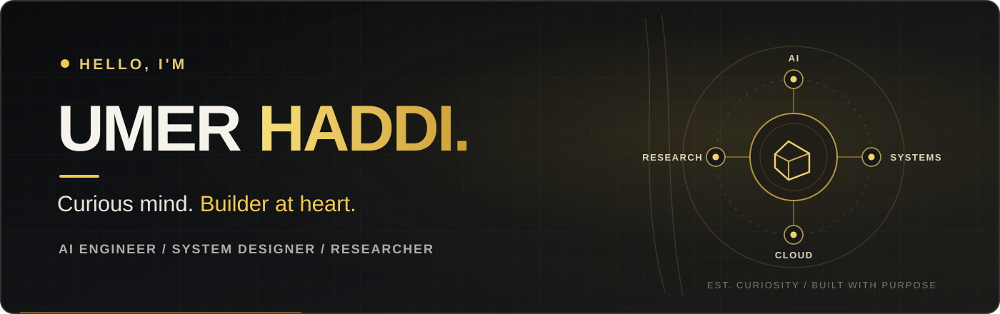
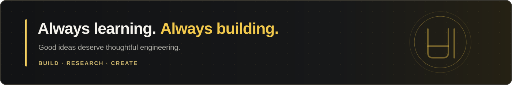

 

Building intelligent systems and turning research into practical reality.

 

---

## ✦ About Me

Hey, I'm **Umer**.

I'm an AI engineer, system designer, and researcher focused on building useful, intelligent systems.

My work sits at the intersection of **AI, System Design, Research, and Cloud Engineering**. I enjoy understanding how things work, improving them, and turning ideas into products that matter.

I'm especially interested in:
- Building with **LLMs and Agentic AI**
- Designing **scalable systems**
- Exploring **research-driven engineering**
- Moving toward **founding meaningful products**

---

## ✦ What I Work On

<table>
<tr>
<td width="50%" valign="top">

### ◈ Artificial Intelligence
- Agentic AI
- Large Language Models
- Open-Source Model Development
- Fine-Tuning
- Deep Learning
- AI Applications

</td>
<td width="50%" valign="top">

### ◈ System Design
- Software Architecture
- Scalable Backend Systems
- API Design & Integrations
- Data Pipelines
- AI System Orchestration
- Product Thinking

</td>
</tr>
<tr>
<td width="50%" valign="top">

### ◈ Research
- Applied AI & ML Research
- Experimentation
- Evaluation & Benchmarking
- Data Science
- Research-to-Production Workflows

</td>
<td width="50%" valign="top">

### ◈ Cloud Engineering
- Cloud Infrastructure
- Deployment Workflows
- Containerized Services
- Compute Pipelines
- Backend & AI Services

</td>
</tr>
</table>

---

## ✦ Selected Public Work

<table>
<tr>
<td width="50%" valign="top">

### [OpenSource AI](https://github.com/umerhaddii/OpenSource-AI-Product-Hunt)
Open-source project focused on AI product discovery.

**Focus:** Open Source · AI Ecosystem

</td>
<td width="50%" valign="top">

### [Stocky](https://github.com/umerhaddii/stocky)
A public software project exploring practical product development.

**Focus:** Software Development

</td>
</tr>
<tr>
<td width="50%" valign="top">

### [F1 Race Data Fetcher](https://github.com/umerhaddii/F1RDF)
Tools for collecting and working with Formula 1 data.

**Focus:** Python · Data Engineering

</td>
<td width="50%" valign="top">

### Language Model Engineering
Hands-on work with training, understanding, and adapting models.

**Focus:** Deep Learning · Model Development

</td>
</tr>
</table>

---

## ✦ Model Development Journey

| Project | Focus |
|:--|:--|
| **GPT-2 124M** | Built from scratch |
| **GPT-2** | Fine-tuning |
| **Gemma 2 2B** | Open-source LLM fine-tuning |
| **Coqui XTTS** | Serbian language adaptation |

These projects helped me understand models beyond APIs — from fundamentals to practical adaptation.

---

## ✦ Let's Connect

I enjoy meeting people who are curious about **AI, research, systems, and building useful products**. If you're exploring an idea or working on something meaningful, I'd be glad to connect.

  

